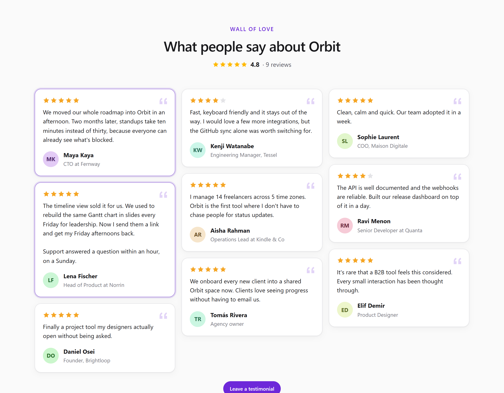
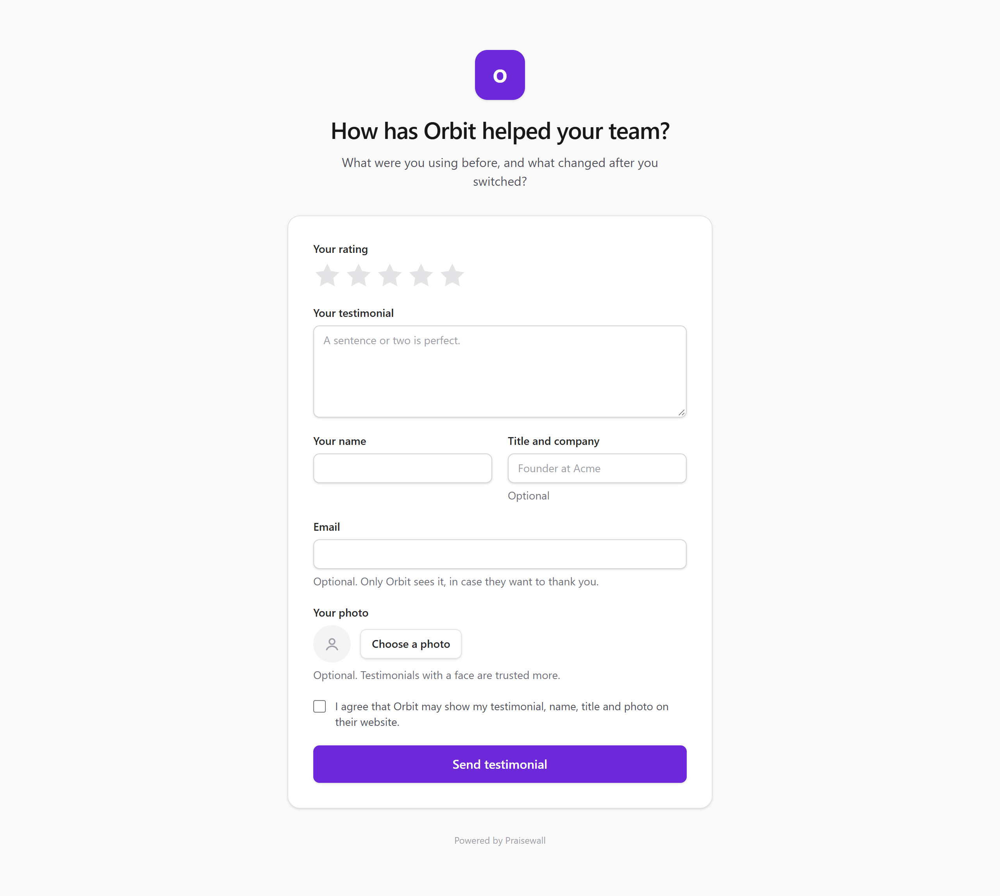
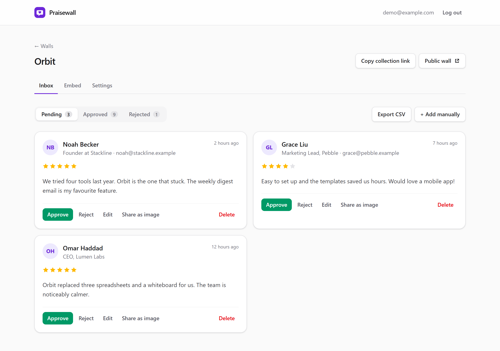
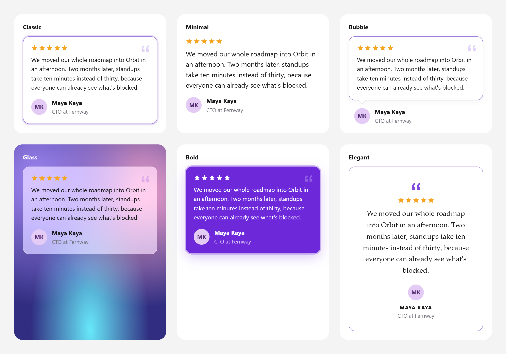
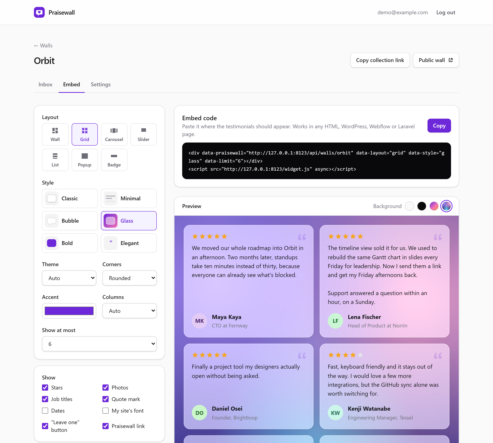
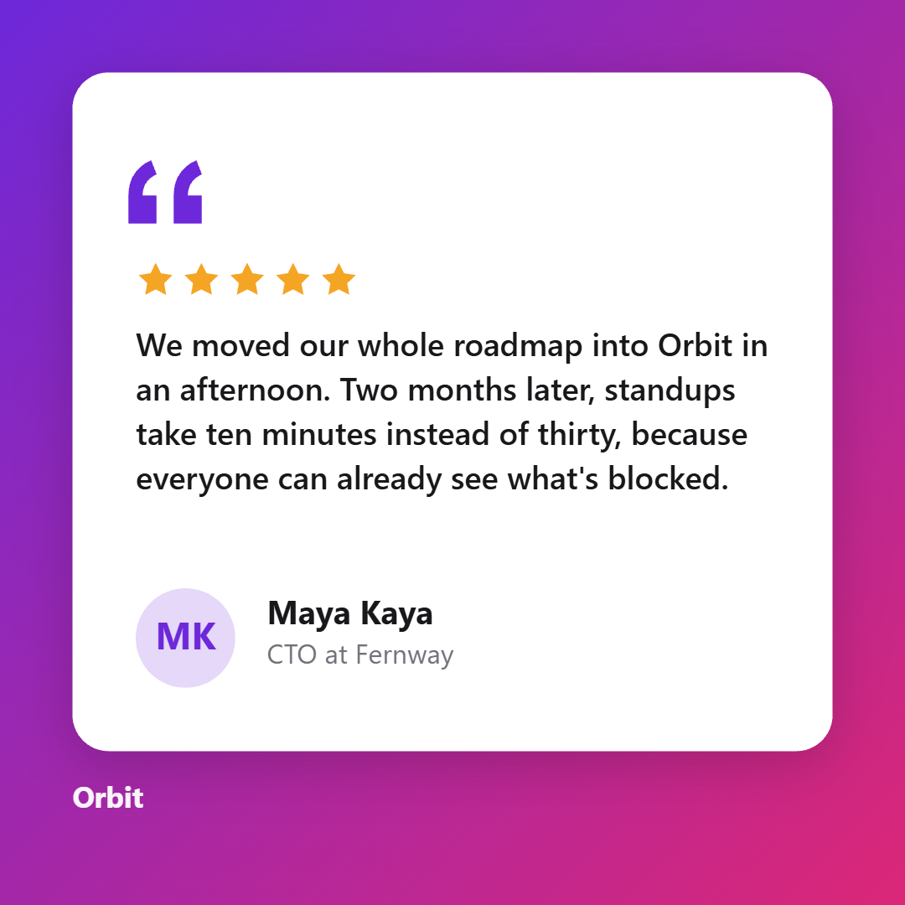

<p align="center"></p>

<h1 align="center">Praisewall</h1>

<p align="center"><b>Collect testimonials with a link. Approve the best ones. Show them on any website with one line.</b><br>
A free, self-hosted alternative to paid testimonial tools. Your customers' words stay on your server.</p>

<p align="center">
  <a href="https://arda-dd.github.io/praisewall/"><b>▶ See the live widget</b></a> ·
  <a href="#quick-start">Quick start</a> ·
  <a href="#embed-it-on-your-site">Embed</a> ·
  <a href="#install-without-docker">Install without Docker</a> ·
  <a href="#faq">FAQ</a>
</p>

<p align="center">
  <a href="https://github.com/Arda-dd/praisewall/actions/workflows/ci.yml"></a>
  <a href="LICENSE"></a>
  
</p>

<p align="center"></p>

## What is it?

Most product websites have a "what our customers say" section. Keeping it up to date usually means copying quotes out of emails by hand, or paying for a hosted tool every month.

Praisewall does the whole loop for you:

1. **Share a link.** Each wall has a page like `/c/your-product`. Send it to happy customers.
2. **Approve.** New testimonials land in your inbox. Nothing goes public until you approve it.
3. **Show.** Paste one line of HTML on your site, and the approved testimonials appear there. New ones show up automatically.

| | |
| --- | --- |
|  |  |
| **The form your customers fill in** | **Your inbox** |

## Features

**Show them off**
- **Seven layouts**: masonry wall, grid, auto-scrolling carousel, slider with arrows, list, a popup that cycles through testimonials in the corner of your page, and a compact "★ 4.8 · 23 reviews" badge.
- **Six styles**: Classic, Minimal, Bubble, Glass, Bold and Elegant. Light, dark or automatic theme, your accent color, four corner shapes, your site's own font.
- **Widget designer**: pick everything with a live preview on light, dark or colorful backgrounds, then copy the code.
- **Share as image**: turn any testimonial into a PNG for LinkedIn, Instagram or X. Six templates, three sizes, made in your browser.
- **One-line embed** that renders in a shadow root, so your site's CSS can't break it and it can't break yours. About 7 KB gzipped, no dependencies, no cookies, no tracking.
- **Public wall page** to link from your site, a profile or an email signature, and a **JSON API** for your own design.

**Collect and manage them**
- **Moderation inbox** with pending, approved and rejected tabs. Pin favourites to the top.
- **Five languages** for the form, the wall and the widget: English, Turkish, German, Spanish and French.
- **Email alerts** when someone leaves a testimonial, and **CSV export** of everything.
- **Ratings and photos**, both optional. People without a photo get colored initials.
- **Add testimonials by hand** from emails, review sites or LinkedIn posts.
- **Many walls**, one per product, service or client, each with its own color, logo, style and language.

**Built carefully**
- **Spam protection** with rate limiting, a honeypot field and a required consent checkbox.
- **Private emails**: the email field is for you only and never reaches the API or the widget.
- **Safe by default**: testimonial text is never rendered as HTML, links must be http(s), and CSV exports defuse spreadsheet formulas.
- **Accessible**: keyboard friendly, screen reader labels, respects reduced motion.

<p align="center"></p>

## Quick start

You need [Docker](https://docs.docker.com/get-docker/).

```bash
git clone https://github.com/Arda-dd/praisewall.git
cd praisewall

# Create a secret key. Keep this file; changing the key logs everyone out.
echo "APP_KEY=base64:$(openssl rand -base64 32)" > .env

docker compose up -d
```

Open **http://localhost:8080**. The first visit asks you to create the admin account. Then create a wall, copy its collection link and send it to a customer.

To run it on a domain, add `APP_URL=https://testimonials.example.com` to `.env` and put it behind your usual reverse proxy (Caddy, Nginx, Traefik). The database, uploads and logs are kept in the `praisewall-storage` volume.

**Update to a new version:**

```bash
git pull
docker compose up -d --build
```

Database changes are applied automatically when the container starts.

## Embed it on your site

Open a wall and go to the **Embed** tab. It's a small designer: pick a layout, style and colors, see the result live, then copy the code. It looks like this:

```html
<div data-praisewall="https://testimonials.example.com/api/walls/orbit" data-layout="masonry"></div>
<script src="https://testimonials.example.com/widget.js" async></script>
```

Paste it where the testimonials should appear. It works in plain HTML, WordPress (Custom HTML block), Webflow (Embed element), Laravel Blade, React and anything else that renders HTML.

<p align="center"></p>

**Options**, all optional:

| Attribute | Values | Default |
| --- | --- | --- |
| `data-layout` | `masonry`, `grid`, `carousel`, `slider`, `list`, `popup`, `badge` | `masonry` |
| `data-style` | `classic`, `minimal`, `bubble`, `glass`, `bold`, `elegant` | the wall's style |
| `data-theme` | `light`, `dark`, `auto` (follows the visitor's setting) | `auto` |
| `data-accent` | A hex color like `#0ea5e9` | the wall's color |
| `data-radius` | `none`, `small`, `medium`, `large` | `medium` |
| `data-font` | `inherit` uses your site's font | system font |
| `data-columns` | Maximum columns for `masonry` and `grid`, 1 to 6 | automatic |
| `data-limit` | Show at most this many testimonials | all |
| `data-hide` | Comma-separated: `rating`, `avatar`, `title`, `quote` | nothing |
| `data-date` | `true` shows when each testimonial was approved | `false` |
| `data-position` | `bottom-left` or `bottom-right`, for `popup` | `bottom-left` |
| `data-interval` | Seconds per testimonial in `slider` and `popup` | `6` |
| `data-cta` | `false` hides the "Leave a testimonial" button | `true` |
| `data-branding` | `false` hides the Praisewall link | `true` |

Visitors can close the popup, and it stays closed for the rest of their visit. The slider and popup pause on hover and don't move at all for visitors who prefer reduced motion.

You can put several widgets on one page. If you add one after the page has loaded, call `Praisewall.mountAll()`.

### Use the JSON API

`GET /api/walls/{slug}` returns the wall's approved testimonials, pinned ones first:

```json
{
  "name": "Orbit",
  "accent_color": "#6d28d9",
  "logo_url": null,
  "wall_url": "https://testimonials.example.com/w/orbit",
  "collect_url": "https://testimonials.example.com/c/orbit",
  "testimonials": [
    {
      "id": 12,
      "body": "We moved our whole roadmap into Orbit in an afternoon.",
      "rating": 5,
      "featured": true,
      "date": "2026-11-17",
      "author": { "name": "Maya Kaya", "title": "CTO at Fernway", "url": null, "avatar_url": null, "initials": "MK" }
    }
  ]
}
```

It also has `style`, `locale`, the widget's texts in the wall's language (`labels`) and a `summary` with the count and average rating. It allows requests from any origin and is cached for a minute.

## Share testimonials as images

Every testimonial has a **Share as image** button. Pick one of six templates and a size (square, LinkedIn landscape or story), choose whether to show the stars, photo and your logo, and download a PNG. The image is drawn in your browser; nothing is uploaded anywhere.

<p align="center"></p>

## Email alerts

Praisewall emails the admin when a new testimonial arrives (you can turn this off per wall). Set up mail in `.env` with your provider's SMTP details:

```ini
MAIL_MAILER=smtp
MAIL_HOST=smtp.example.com
MAIL_PORT=587
MAIL_USERNAME=you@example.com
MAIL_PASSWORD=your-password
MAIL_FROM_ADDRESS=testimonials@example.com
```

With Docker, put them in the same `.env` file as `APP_KEY` and run `docker compose up -d` again. If mail isn't set up, nothing breaks: the testimonial is still saved.

## Install without Docker

Praisewall is a standard Laravel app, so it runs on most PHP hosting, including shared hosting with cPanel.

**Requirements:** PHP 8.3 or newer with the `pdo_sqlite` (or `pdo_mysql`) and `fileinfo` extensions, [Composer](https://getcomposer.org/), and [Node.js](https://nodejs.org/) 22 or newer to build the assets.

```bash
git clone https://github.com/Arda-dd/praisewall.git
cd praisewall
composer install --no-dev --optimize-autoloader
npm ci && npm run build

cp .env.example .env
php artisan key:generate
# Edit .env: set APP_URL, APP_ENV=production and APP_DEBUG=false

touch database/database.sqlite
php artisan migrate --force
php artisan storage:link
```

Point your web server's document root at the `public` folder, then open the site to create your account.

**MySQL or PostgreSQL** instead of SQLite: set `DB_CONNECTION`, `DB_HOST`, `DB_DATABASE`, `DB_USERNAME` and `DB_PASSWORD` in `.env` before running the migrations.

**Shared hosting:** if you can't run Node.js on the server, run `npm ci && npm run build` on your computer and upload the `public/build` folder and `public/widget.js` along with the rest.

## Try it with sample data

```bash
php artisan migrate
php artisan db:seed --class=DemoSeeder
php artisan serve
```

Log in at http://127.0.0.1:8000 with `demo@example.com` / `password`. There are two walls: Orbit in English and Atölye Kahve in Turkish. The people and companies in the sample data are made up.

## FAQ

**Is it really free?**
Yes. It's MIT licensed. You host it yourself, so the only cost is your server, and it runs fine on a small one.

**What do my customers need?**
Nothing. They open the link, write a few sentences and press send. No account.

**Can I edit a testimonial?**
Yes, to fix a typo. Please keep the customer's words; that's why people trust the wall.

**Can spam get through?**
Not onto your website. Every testimonial from the form waits for your approval. The form also has rate limiting and a honeypot to keep the inbox clean.

**Can I remove "Powered by Praisewall"?**
Yes, untick it on the Embed tab or add `data-branding="false"`. Keeping it is a nice way to say thanks.

**Does the widget slow down my site?**
It's about 7 KB gzipped, loads with `async`, and makes one small request.

**Can I add another language?**
Yes. Copy `lang/en/praisewall.php` to `lang/xx/praisewall.php`, translate it, and add the language to `config/praisewall.php`. A pull request would be very welcome.

**Video testimonials?**
Not yet. Contributions are welcome.

## Development

```bash
composer install && npm install
cp .env.example .env && php artisan key:generate
touch database/database.sqlite && php artisan migrate --seed --seeder=DemoSeeder

php artisan serve      # the app
npm run dev            # assets with hot reload
npx vite build -c vite.widget.config.js --watch   # the widget
```

Checks, the same ones CI runs:

```bash
php artisan test        # feature tests
vendor/bin/pint --test  # code style
npm run typecheck       # widget types
npm test                # widget tests
```

The widget lives in [`resources/widget`](resources/widget) and has no runtime dependencies. The README screenshots come from [`scripts/screenshots.cjs`](scripts/screenshots.cjs).

## License

[MIT](LICENSE)
